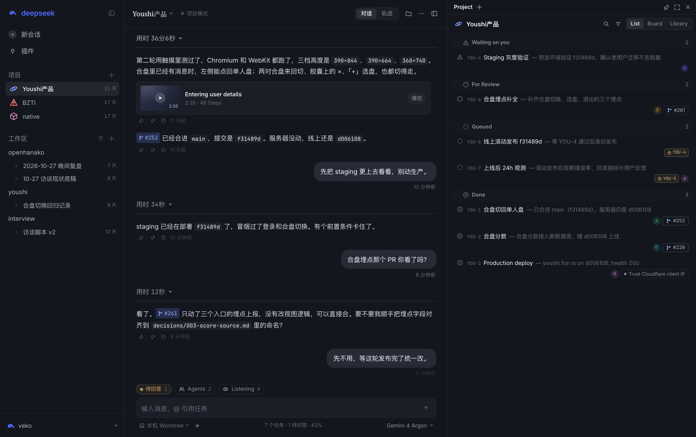

# dsh-projects

在 [DeepSeek Harness](https://github.com/deepseek-ai/deepseek-harness)（DSH）上实现 **Projects**：把 agent 的工作单元从「一次会话」提升为「一个持久项目」。左栏是项目，中栏是常驻的协调者，右栏是 `List | Board | Library` 项目面板；协调者拆任务、派 worker、收结果，每个 worker 在独立 git worktree 里干活，交付 PR 与可验证的证据。



## 当前阶段

| 部分 | 状态 |
|---|---|
| 交互原型 `prototype/index.html` | 可用，纯前端，浏览器直接打开 |
| 架构设计 v2 | 已定稿，见 [docs/architecture/overview.md](docs/architecture/overview.md) |
| 实现 | 未开始；下一步是宿主 spike 与 M0 最薄闭环，见 [路线图](docs/architecture/roadmap.md) |

## 先读这些

1. [架构总览](docs/architecture/overview.md)：要解决什么、设计原则、分层、一次任务的生命周期
2. [域模型](docs/architecture/domain-model.md)：对象、不变量、状态推导、Schema
3. [交互规格](docs/design/interaction-spec.md)：三栏界面、托盘、看板、设置
4. [决策记录](docs/adr/)：为什么这样设计

完整目录见 [docs/README.md](docs/README.md)。

## 打开原型

```bash
open prototype/index.html          # 默认 DeepSeek 色卡
open "prototype/index.html?brand=claude"   # Claude 色卡
```

状态都在内存里，刷新即还原；环境偏好记在 localStorage。深链：`#board`、`#library`、`#detail=YOU-4`、`#tray`、`#new`、`#project=bzti`。截图集见 [docs/design/screenshots.md](docs/design/screenshots.md)。

## 仓库结构

```
prototype/            交互原型（单文件）与字体
docs/
  architecture/       现行架构：总览、域模型、运行时、宿主集成、路线图
  design/             交互规格、原型对齐、DSH 原生 UI 规则、截图集
  adr/                架构决策记录
  research/           调研：LoopX、开源对比、Cursor / Claude Code / dsh-superagent 拆解、源码核查
  assets/screenshots/ 原型截图
archive/              已被取代的原型版本与旧设计稿，只读留档
```

## 参考

- [deepseek-ai/deepseek-harness](https://github.com/deepseek-ai/deepseek-harness)
- [deepseek-ai/dsh-superagent-prototype](https://github.com/deepseek-ai/dsh-superagent-prototype)
- [loopx-project/loopx](https://github.com/loopx-project/loopx)
- [BloopAI/vibe-kanban](https://github.com/BloopAI/vibe-kanban)、[OrchestratorInc/agent-orchestrator](https://github.com/OrchestratorInc/agent-orchestrator)、[sst/opencode](https://github.com/sst/opencode)
