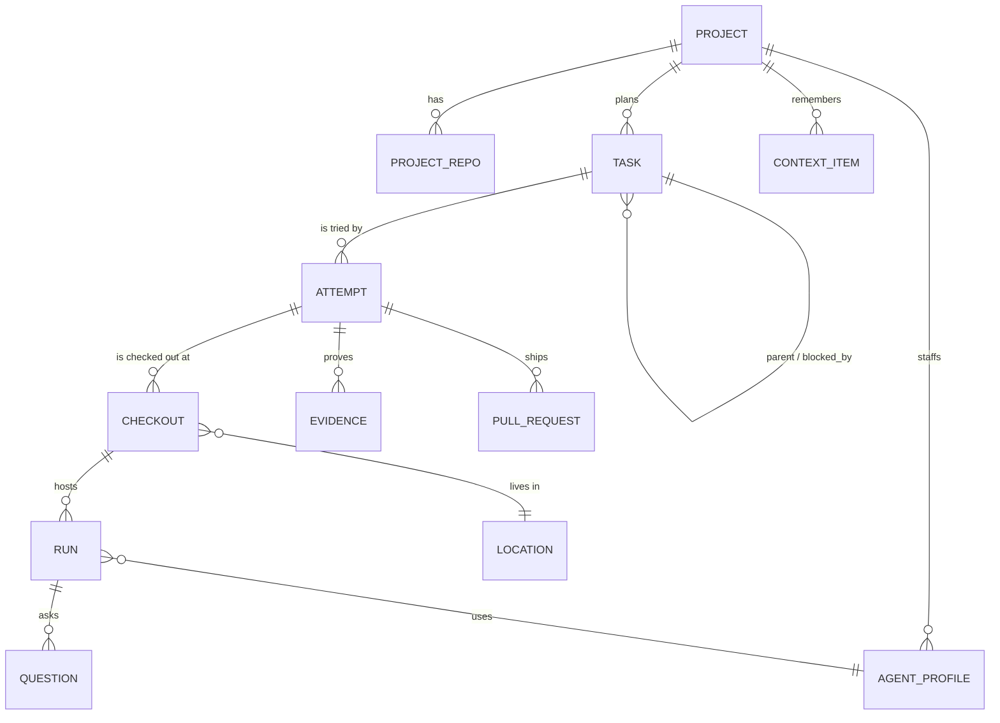

# 域模型

> 状态：现行（v5，2026-11-09，加入执行者 × 模型 × 位置及原位验证/授权/恢复不变量，见 [execution.md](execution.md)）。本页定义的名词在代码、工具、UI 文案和其他文档里统一使用，不另起别名。

## 1. 对象总览



| 对象 | 是什么 | 原型中的对应 |
|---|---|---|
| **Project** | 跨周跨月存活的作用域：名字、外观、目标、仓库组（0..N 个，支持无仓库调研项目）、协调者会话、上下文目录、设置 | 左栏项目、项目设置 |
| **ProjectRepo** | 项目挂载的一个仓库：别名、本地路径、远端、默认分支、是否主仓库、仓库级验证配置、refs 同步时间 | 设置里的仓库、主仓库、默认分支、refs 同步 |
| **AgentProfile** | 项目里的一个「成员」：一组可复用的运行偏好（显示名、头像色、执行者、模型、effort、权限、默认位置）。人类成员也是一条 profile（`kind=human`） | 成员、负责人头像 |
| **Task** | 计划项，编号 `<PREFIX>-<n>`（如 `YOU-4`），可有父子与依赖、目标仓库 `repo_alias` | 右栏任务行 / 看板卡片 |
| **Attempt** | 对一个 Task 的一次尝试 = 一条工作分支（仓库 + 基线 + 分支 + 当前 `head_sha`；无仓库项目时分支字段为空），与位置无关；best-of-N 时一个 Task 有多个并行 Attempt | 任务详情里的仓库、分支 |
| **Checkout** | Attempt 的分支在某个位置上的一份检出（本地 worktree、SSH 主机目录、容器、沙箱） | worktree 路径、环境 |
| **Run** | 一个执行者会话（DSH 会话或 ACP 会话），绑定一个 Checkout，持有不可变的 RunSpec（执行者、模型、effort、权限、位置、凭据来源）与 Mandate | 任务详情的 worker、日志、过程 |
| **Question** | worker 或协调者向人的提问 / 审批 | Question Tray |
| **Evidence** | 验证结果与工件：测试输出、CI 结论、截图、录屏、diff 统计 | 详情里的检查结果、Library artifacts |
| **PullRequest** | PR 事实：编号、状态、checks、review、合并 sha | PR 胶囊、PR 详情 |
| **ContextItem** | Library 中一份上下文文件的索引（正文在磁盘） | Library 的 INDEX / decisions / runbooks / specs |
| **Location** | 执行位置：`local`、`ssh:<host>`、`docker:<name>`、`sandbox:<provider>/<env>`；带健康检查历史 | 输入区环境菜单、启动摘要 |
| **Executor** | 已登记的执行者（DSH、Claude Code、Codex…）及其在各位置上的可用性、能力与模型目录（缓存，不是真相） | 设置 → Agents |
| **ProjectEvent** | 审计事件（设置变更、分支操作、生命周期操作） | 轨迹页「最近活动」 |

> 关键区分：**AgentProfile 是长期的「谁 + 怎么做」，Run 是一次性的「这一回」。** 原型里的成员 `a8f2`、`e4b1` 是 profile；改负责人 = 用另一个 profile 开新 Run，旧 Run 结束。
>
> **Attempt / Checkout / Run 三层**让「换位置」和「换执行者」都不丢工作：分支（Attempt）是要保住的状态，检出（Checkout）随位置可丢可重建，会话（Run）随执行者可换。

## 2. 不变量

**Project**
- 恰好一个协调者会话；协调者会话被删除时自动重建，不丢项目状态。
- 任务前缀在全局唯一；`next_seq` 只增不减，删除任务不回收编号。
- 删除项目只清本地状态、上下文目录与受管 worktree，**永不删除远端分支与 PR**。

**Task**
- 只存**意图** `intent ∈ {backlog, ready, canceled, accepted}`，显示状态由 §3 推导。
- 依赖图无环；被依赖未 `accepted` 的 Task 不得启动 Attempt。
- `accepted` 只能由人调用 `task.accept` 写入，且必须写 `successor`：后继 Task id，或 `no_followup:<理由>`。
- 接受前必须没有 live worker Run、未完成的写类 effect 或 open gate；Engine 固定被接受的 `attempt_id / head_sha`。未经验证接受需要二次确认，并记录 `accepted_unverified=1`。
- accepted Task 不再接收任何 Run 写入；迟到的 MCP 命令、Run 回调和 effect 回执必须被拒绝或只记入隔离审计，不得改写已接受版本。
- PR merge 是外部事实，不自动写入 `accepted`。只有人完成 `task.accept` 后 Done 才命中，依赖才解锁。
- 有过 Attempt 的 Task 不能物理删除，只能 `canceled`；从未执行过的可以删除。

**Attempt / Checkout / Run**
- 一个 Task 同一时刻最多一个 live Attempt；best-of-N 时最多 4 个，各候选独立申请 `WorkerSlot`（有空槽即跑，其余显式排队 `Queued (slot)`），人采用其一后其余标 `superseded`。
- 一个 Attempt 同一时刻最多一个 live Checkout、一个执行中的 worker Run（单 lane 单执行者）；reviewer Run 只读，可并存，且与 `validate` 一样优先复用刚释放的槽位。
- 有仓库项目的 Attempt 必须指定 `repo_alias / base_ref / branch`（未显式传 `task.repo_alias` 时默认取项目 `is_primary=1` 的主仓库）；无仓库项目的 `repo_alias / base_ref / branch / head_sha` 允许为空，Checkout 直接使用受管空工作目录 `<dataDir>/workspaces/<project>/<attempt>`。
- Checkout 可丢弃可重建，**分支是要保住的状态**；已 push 的分支不改名。
- RunSpec 启动后不可变；DSH 原生会话的运行中切模型记为 `run_event`。
- 每个 Run 同时持有不可猜的 `run_capability`，绑定 project/task/attempt/run、repo/path scope、role、Mandate policy version、能力集合、签发/过期时间和撤销 epoch。所有 projects-mcp 命令由 Engine 按 capability 再校验；Task token 不是授权本身。
- `reviewer` 和 `permission=read-only` Run 不能写 Task、ContextItem、Evidence 或 artifact；跨 repo、跨 Attempt、超出路径范围、过期或撤销 capability 的请求 fail-closed。
- Run 结束不等于 Attempt 结束：可以换 profile、换执行者、换模型、换位置继续同一 Attempt（交接流程见 execution.md §5）。
- 远端位置的 Run 只能使用 API Key 凭据；`credential=cli-login` 只允许 `location=local`。Host lease 失效后，远端 Run 进入 `stale`，暂停写入并等待重新对账。

**Question**
- 带 `kind ∈ {gate, request, wish}` 与 `scope ∈ {action, attempt, task, project}`。
- 只有 `gate` 阻塞，且只阻塞其 scope 覆盖的范围；scope 不明时按阻塞处理（fail-closed）。
- 有 open gate 的 Run 不接受自动续跑消息，只接受人的回答。

**Evidence**
- `status ∈ {claimed, verified, failed}`；worker 只能写 `claimed`，只有 validator / CI 观察者能写 `verified` 或 `failed`。
- 有仓库 Attempt 的 Evidence 必须记录生成该证据时的 `commit_sha`、`tree_sha`、`policy_revision`、`policy_hash`、运行位置和结果引用；仅当证据的 commit/tree、策略版本与 Attempt 当前值全部匹配时视为有效。worker 产生新提交、tree 变化或策略变化后，旧 `verified` Evidence 自动失效。`head_sha` 在 `task_report`、Run 退出、交接 / sync、PR head 变更与 `validate` 起止时刷新（见 runtime.md §4），不只在 validate 时更新。无仓库 Attempt 的 commit/tree SHA 允许为空，但仍须绑定策略版本与固定输入快照。
- validator 只能在 worker Run 退出、写 capability 撤销、Checkout 冻结（已固化 WIP commit 并记录 `commit_sha / tree_sha`）且无未完成写 effect 后，在原 Checkout 上原位执行；验证结束后复核 `tree_sha` 与 `git status --porcelain`，若验证期间发现 HEAD、tree、受跟踪文件或策略 hash 变化，结果只能写 `failed`/`stale`，不得写当前有效的 `verified`。

**ContextItem**
- `status ∈ {proposed, ratified, disputed, superseded}`；runbook 只有在关联 Attempt 存在当前有效的 `verified` Evidence 时才能从 `proposed` 转 `ratified`。

## 3. 显示状态推导

右栏分组、看板泳道、左栏徽标、协调者摘要都调用同一个纯函数 `deriveTaskView(task, facts)`。**判定优先级按以下顺序取第一条命中**（终态优先于运行态，活跃运行态优先于待审态）：

| 判定序 | 显示状态 | 原型 id | 命中条件 | 附加标记 |
|---|---|---|---|---|
| 1 | **Canceled** | `canceled` | `intent=canceled` | — |
| 2 | **Done** | `done` | `intent=accepted` | `merged` |
| 3 | **Waiting on you** | `waiting` | 有覆盖该 Task 的 open `gate` Question（含执行者权限请求）；或 live Run 为 `waiting_input / blocked / stale`；或存在 `unknown` effect、Host 失联或消息投递连续失败；或最新 Run 异常退出且结束时间晚于当前 Attempt 最近一次 `queued_at`（之后尚无人类回应或重排） | `question` / `failed` / `undelivered` / `host_unreachable` / `unknown` |
| 4 | **In Progress** | `working` | 有 live Run 为 `active`（含 PR 返工与 best-of-N 候选运行中），或为 `idle` 且后台作业未结束 | 15 秒单行摘要 |
| 5 | **For Review** | `review` | 无活跃 worker Run，且满足其一：有 open PR；或当前 `attempt.head_sha` 上有匹配的有效 `verified` Evidence（无仓库项目为有最新 `verified` Evidence）；或 best-of-N 全部候选已结束 | `ci_failing` / `changes_requested` / `mergeable` / `pick_1_of_n` |
| 6 | **Queued** | `queued` | `intent=ready` 且尚未分配槽位（含失败后刚触发重排等待槽位）；或依赖未满足 | `blocked_by:[…]` / `slot` |
| 7 | Backlog（默认折叠） | — | `intent=backlog` | — |

UI 展示时的分组排列顺序固定为 `GROUP_ORDER = ['waiting','review','working','queued','done','canceled']`。判定序把 `Canceled / Done` 放在最前、把 `In Progress` 放在 `For Review` 之前，确保：① 带未决提问或旧证据的任务仍可随时取消或接受；② 已提 PR 的任务在收到 review 意见重新启动 worker 返工时，能正确回到 `In Progress`；③ 失败任务点击重试/重排刷新 `attempt.queued_at` 后，即使并发槽已满也能立即进入 `Queued` 而不会卡死在 `Waiting on you`。

`Done` 只表示人的 `task.accept` 已成功写入 `intent=accepted`，并固定接受时的 `accepted_head_sha`；`merged` 只是 PR 外部事实的附加标记，不会自动改变 Task 意图或解锁依赖。未经验证接受的 Task 仍可 Done，但必须保留 `accepted_unverified` 审计事实。

### 人在 UI 上「改状态」时实际发生什么

状态是推导的，所以状态菜单与看板拖拽映射为**命令**，而不是直接写状态：

| 用户操作（原型） | 命令 | 允许条件 |
|---|---|---|
| 拖到 / 选 Queued | `task.ready` | 当前为 backlog / canceled，或 working 时先 `run.stop` 确认 |
| 拖到 / 选 In Progress | `attempt.start` | 依赖满足；环境可用；否则弹启动摘要说明原因 |
| 拖到 / 选 For Review | 不提供 | 由事实决定，菜单项置灰并提示原因 |
| 拖到 / 选 Waiting on you | 不提供 | 同上 |
| 拖到 / 选 Done | `task.accept` | 仅作为命令入口；弹窗要求后继或 no_followup，并展示 accepted head；无 verified Evidence 时二次确认「未经验证接受」；有 live Run、写 effect 或 open gate 时阻断 |
| 拖到 / 选 Canceled | `task.cancel` | 有 live Run 时先停止或 fence |
| 组内拖拽排序 | `task.reorder` | 任意 |

## 4. 授权（Mandate）

```ts
type Mandate = {
  origin: 'chat' | 'source'
  grantedBy: string            // 用户 id 或 Source 上的发起人
  scope: { project: string; task?: string; repos: string[]; paths: string[]; actions: string[]; write: boolean }
  policyVersion: string
  evidence: string             // chat 消息 id 或 Trigger id
}
```

Mandate 不可变；扩大范围必须开新 Run。订阅只传上下文，不传权限（沿用 dsh-superagent 原则）。

## 5. SQLite Schema（v1 草案）

```sql
CREATE TABLE project (
  id TEXT PRIMARY KEY,
  prefix TEXT NOT NULL UNIQUE,
  next_seq INTEGER NOT NULL DEFAULT 1,
  name TEXT NOT NULL,
  appearance_json TEXT NOT NULL,         -- {icon, colorId} | {letter} | {customImage, fit, scale}
  goal TEXT NOT NULL DEFAULT '',
  coordinator_session_id TEXT NOT NULL,
  context_dir TEXT NOT NULL,
  settings_json TEXT NOT NULL,           -- 角色默认 RunSpec（worker / reviewer）、协调者模型、默认位置、并发上限、预算
  state TEXT NOT NULL DEFAULT 'active',  -- active | paused | archived
  pinned INTEGER NOT NULL DEFAULT 0,
  revision INTEGER NOT NULL DEFAULT 0,
  created_at TEXT NOT NULL,
  updated_at TEXT NOT NULL
);

CREATE TABLE project_repo (
  project_id TEXT NOT NULL,
  alias TEXT NOT NULL,
  path TEXT NOT NULL,
  remote TEXT,
  default_branch TEXT NOT NULL,
  is_primary INTEGER NOT NULL DEFAULT 0,
  validation_policy_json TEXT,            -- 用户确认的受信验证策略；.dsh/environment.json 只可提议，不直接覆盖
  validation_policy_hash TEXT,
  validation_policy_revision INTEGER NOT NULL DEFAULT 0,
  validation_policy_approved_at TEXT,
  refs_json TEXT NOT NULL DEFAULT '[]',
  refs_synced_at TEXT,
  PRIMARY KEY (project_id, alias)
);

CREATE TABLE agent_profile (
  id TEXT PRIMARY KEY,
  project_id TEXT NOT NULL,
  kind TEXT NOT NULL,                    -- human | agent
  label TEXT NOT NULL,
  color TEXT NOT NULL,
  executor TEXT,                         -- dsh | claude-code | codex | gemini | opencode | cursor | <custom>
  model TEXT,
  effort TEXT,
  permission TEXT,                       -- read-only | workspace-write | full
  default_location TEXT,
  preset TEXT                            -- 仅 executor=dsh
);

CREATE TABLE task (
  id TEXT PRIMARY KEY,                   -- YOU-4
  project_id TEXT NOT NULL,
  seq INTEGER NOT NULL,
  parent_id TEXT,
  title TEXT NOT NULL,
  body TEXT NOT NULL DEFAULT '',
  intent TEXT NOT NULL,                  -- backlog | ready | canceled | accepted
  assignee_profile_id TEXT,
  repo_alias TEXT,                       -- 多仓项目指向具体仓库；未传时回退至 is_primary=1 主仓库；无仓库项目为 NULL
  ordinal REAL NOT NULL,
  successor TEXT,                        -- 'YOU-5' | 'no_followup:<理由>'
  accepted_unverified INTEGER NOT NULL DEFAULT 0,
  accepted_at TEXT,
  created_at TEXT NOT NULL,
  updated_at TEXT NOT NULL,
  UNIQUE (project_id, seq)
);

CREATE TABLE task_dep (
  task_id TEXT NOT NULL,
  blocked_by TEXT NOT NULL,
  PRIMARY KEY (task_id, blocked_by)
);

CREATE TABLE attempt (
  id TEXT PRIMARY KEY,
  task_id TEXT NOT NULL,
  repo_alias TEXT,                       -- 无仓库项目为 NULL；有仓库项目由 Engine 强制非空
  base_ref TEXT,                         -- 无仓库项目为 NULL
  branch TEXT,                           -- agent/you-4-staging-verify；无仓库项目为 NULL
  head_sha TEXT,                         -- 当前分支 HEAD commit SHA；用于校验 Evidence 是否过期
  accepted_head_sha TEXT,                -- Task accepted 时固定的代码版本
  state TEXT NOT NULL,                   -- live | adopted | superseded | ended
  preserved_ref TEXT,
  queued_at TEXT NOT NULL,               -- 最近一次排队/重试时间戳
  created_at TEXT NOT NULL,
  ended_at TEXT
);

CREATE TABLE checkout (
  id TEXT PRIMARY KEY,
  attempt_id TEXT NOT NULL,
  location_id TEXT NOT NULL,
  path TEXT,                             -- 位置内路径
  state TEXT NOT NULL,                   -- preparing | ready | released | failed
  env_snapshot TEXT,                     -- 环境快照 / 镜像 id
  created_at TEXT NOT NULL,
  released_at TEXT
);

CREATE TABLE run (
  id TEXT PRIMARY KEY,
  checkout_id TEXT NOT NULL,
  profile_id TEXT,
  role TEXT NOT NULL,                    -- worker | reviewer
  spec_json TEXT NOT NULL,               -- RunSpec，不可变
  transport TEXT NOT NULL,               -- dsh-native | acp
  session_ref TEXT NOT NULL,             -- 事务内预生成的确定性 DSH session id 或 ACP sessionId
  native_ref TEXT,                       -- 执行者自身会话 id（用于续接 / 交接）
  mandate_json TEXT NOT NULL,            -- 不可变授权来源与范围
  capability_hash TEXT NOT NULL,         -- run_capability 的哈希；原始 token 不入库
  capability_epoch INTEGER NOT NULL DEFAULT 0,
  capability_expires_at TEXT,
  host_lease_id TEXT,
  activity TEXT NOT NULL,                -- active | idle | waiting_input | blocked | stale | exited
  exit_reason TEXT,
  summary TEXT NOT NULL DEFAULT '',
  usage_json TEXT,                       -- tokens / cost，执行者提供时
  started_at TEXT NOT NULL,
  ended_at TEXT
);

CREATE TABLE run_event (
  run_id TEXT NOT NULL,
  seq INTEGER NOT NULL,
  kind TEXT NOT NULL,                    -- turn_end | tool_call | plan | permission | usage | state | model_switched | handoff
  body_json TEXT NOT NULL,
  at TEXT NOT NULL,
  PRIMARY KEY (run_id, seq)
);                                       -- 仅存低频生命周期与工具边界事件（不挂 change_log 触发器）；高频流式 chunk 走内存 SSE 与 <dataDir>/runs/<run_id>.jsonl

CREATE TABLE question (
  id TEXT PRIMARY KEY,
  task_id TEXT NOT NULL,
  run_id TEXT,
  kind TEXT NOT NULL,                    -- gate | request | wish
  scope TEXT NOT NULL,                   -- action | attempt | task | project
  body TEXT NOT NULL,
  options_json TEXT,
  answer TEXT,
  state TEXT NOT NULL,                   -- open | answered | withdrawn | unknown
  protocol TEXT,                         -- acp-permission | projects-mcp | other
  protocol_request_id TEXT,              -- ACP 原始 permission request id
  run_epoch INTEGER,
  created_at TEXT NOT NULL,
  answered_at TEXT
);

CREATE TABLE evidence (
  id TEXT PRIMARY KEY,
  attempt_id TEXT NOT NULL,
  commit_sha TEXT,                       -- 固定被测 commit；有仓库时必填
  tree_sha TEXT,                         -- 固定被测 Git tree / 输入快照
  policy_revision INTEGER NOT NULL,
  policy_hash TEXT NOT NULL,
  location_id TEXT,
  command_summary TEXT,
  kind TEXT NOT NULL,                    -- test | ci | artifact | diffstat
  status TEXT NOT NULL,                  -- claimed | verified | failed | stale
  ref TEXT,
  detail_json TEXT,
  created_at TEXT NOT NULL
);

CREATE TABLE pull_request (
  url TEXT PRIMARY KEY,
  attempt_id TEXT NOT NULL,
  number INTEGER NOT NULL,
  state TEXT NOT NULL,                   -- open | merged | closed
  checks TEXT,                           -- pending | passing | failing
  review TEXT,                           -- none | approved | changes_requested
  merged_sha TEXT,
  synced_at TEXT NOT NULL
);

CREATE TABLE context_item (
  project_id TEXT NOT NULL,
  rel_path TEXT NOT NULL,
  layer TEXT NOT NULL,                   -- index | decision | spec | runbook | artifact | upload
  status TEXT NOT NULL,                  -- proposed | ratified | disputed | superseded
  source_task_id TEXT,
  evidence_id TEXT,
  tokens INTEGER NOT NULL DEFAULT 0,
  updated_at TEXT NOT NULL,
  PRIMARY KEY (project_id, rel_path)
);

CREATE TABLE location (
  id TEXT PRIMARY KEY,                   -- local | ssh:my-vps | docker:dev | sandbox:e2b/default
  kind TEXT NOT NULL,                    -- local | ssh | docker | sandbox
  label TEXT NOT NULL,
  config_json TEXT NOT NULL,             -- 主机、提供商、凭据引用、retryPolicy
  last_check_json TEXT,                  -- {ok, durationMs, at, error}
  history_json TEXT NOT NULL DEFAULT '[]'
);

CREATE TABLE executor_probe (
  executor TEXT NOT NULL,
  location_id TEXT NOT NULL,
  available INTEGER NOT NULL,
  auth TEXT,                             -- cli-login | api-key | none
  version TEXT,
  capabilities_json TEXT,
  catalog_json TEXT,                     -- 模型目录缓存
  checked_at TEXT NOT NULL,
  PRIMARY KEY (executor, location_id)
);

CREATE TABLE project_event (
  id TEXT PRIMARY KEY,
  project_id TEXT NOT NULL,
  kind TEXT NOT NULL,                    -- settings | branch | lifecycle | task
  text TEXT NOT NULL,
  actor TEXT NOT NULL,
  at TEXT NOT NULL
);

CREATE TABLE effect (
  kind TEXT NOT NULL,
  key TEXT NOT NULL,
  operation_id TEXT NOT NULL UNIQUE,      -- 外部操作稳定 ID，用于 receipt / reconcile
  lane_key TEXT NOT NULL,                 -- 串行域键，如 'attempt:att-1'；同 lane_key 严格串行互斥
  state TEXT NOT NULL DEFAULT 'queued',   -- queued | dispatching | awaiting_receipt | succeeded | retryable | unknown | failed
  claimed_at TEXT,
  dispatched_at TEXT,
  receipt_json TEXT,                      -- 外部确认结果；无确认时不可推断成功
  external_ref TEXT,                      -- provider session/message/job ref
  payload_json TEXT NOT NULL,
  attempts INTEGER NOT NULL DEFAULT 0,
  not_before TEXT,
  last_error TEXT,
  PRIMARY KEY (kind, key)
);

CREATE TABLE change_log (
  seq INTEGER PRIMARY KEY AUTOINCREMENT,
  entity TEXT NOT NULL,
  entity_id TEXT NOT NULL,
  op TEXT NOT NULL,
  at TEXT NOT NULL
);
```

`change_log` 由业务实体表（`project`、`task`、`attempt`、`checkout`、`run`、`question`、`evidence`、`pull_request`、`context_item`）的触发器写入，不对 `run_event` 和 `effect` 挂触发器；SSE 推送按 `seq` 水位，客户端断线后用 `since=<seq>` 补发。
