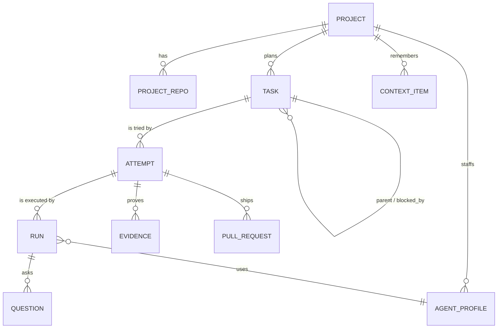

# 域模型

> 状态：现行（v2，2026-11-08）。本页定义的名词在代码、工具、UI 文案和其他文档里统一使用，不另起别名。

## 1. 对象总览



| 对象 | 是什么 | 原型中的对应 |
|---|---|---|
| **Project** | 跨周跨月存活的作用域：名字、外观、目标、仓库组、协调者会话、上下文目录、设置 | 左栏项目、项目设置 |
| **ProjectRepo** | 项目挂载的一个仓库：别名、本地路径、远端、默认分支、是否主仓库、refs 同步时间 | 设置里的仓库、主仓库、默认分支、refs 同步 |
| **AgentProfile** | 项目里的一个「成员」：一个可复用的 worker 配置（显示名、头像色、模型、preset、执行环境）。人类成员也是一条 profile（`kind=human`） | 成员、负责人头像 |
| **Task** | 计划项，编号 `<PREFIX>-<n>`（如 `YOU-4`），可有父子与依赖 | 右栏任务行 / 看板卡片 |
| **Attempt** | 对一个 Task 的一次执行：仓库 + 基线分支 + 工作分支 + worktree | 任务详情里的仓库、分支、worktree |
| **Run** | Attempt 与一个 DSH worker 会话的绑定（≈ dsh-superagent 的 Assignment），持有 Mandate | 任务详情的 worker、日志、过程 |
| **Question** | worker 或协调者向人的提问 / 审批 | Question Tray |
| **Evidence** | 验证结果与工件：测试输出、CI 结论、截图、录屏、diff 统计 | 详情里的检查结果、Library artifacts |
| **PullRequest** | PR 事实：编号、状态、checks、review、合并 sha | PR 胶囊、PR 详情 |
| **ContextItem** | Library 中一份上下文文件的索引（正文在磁盘） | Library 的 INDEX / decisions / runbooks / specs |
| **Environment** | 执行环境：本机 worktree、远程 sandbox 等；带健康检查历史 | 输入区环境菜单、启动摘要 |
| **ProjectEvent** | 审计事件（设置变更、分支操作、生命周期操作） | 轨迹页「最近活动」 |

> 关键区分：**AgentProfile 是长期的「谁」，Run 是一次性的「这一回」。** 原型里的成员 `a8f2`、`e4b1` 是 profile；改负责人 = 用另一个 profile 开新 Run，旧 Run 结束。

## 2. 不变量

**Project**
- 恰好一个协调者会话；协调者会话被删除时自动重建，不丢项目状态。
- 任务前缀在全局唯一；`next_seq` 只增不减，删除任务不回收编号。
- 删除项目只清本地状态、上下文目录与受管 worktree，**永不删除远端分支与 PR**。

**Task**
- 只存**意图** `intent ∈ {backlog, ready, canceled, accepted}`，显示状态由 §3 推导。
- 依赖图无环；被依赖未 `accepted` 的 Task 不得启动 Attempt。
- `accepted` 时必须写 `successor`：后继 Task id，或 `no_followup:<理由>`。
- 有过 Attempt 的 Task 不能物理删除，只能 `canceled`；从未执行过的可以删除。

**Attempt / Run**
- 一个 Task 同一时刻最多一个 live Attempt；一个 Attempt 同一时刻最多一个执行中的 Run（单 lane 单执行者）。
- worktree 可丢弃可重建，**分支是要保住的状态**；已 push 的分支不改名。
- Run 结束不等于 Attempt 结束：可以换 profile、换模型、换 reviewer 继续同一 Attempt。

**Question**
- 带 `kind ∈ {gate, request, wish}` 与 `scope ∈ {action, attempt, task, project}`。
- 只有 `gate` 阻塞，且只阻塞其 scope 覆盖的范围；scope 不明时按阻塞处理（fail-closed）。
- 有 open gate 的 Run 不接受自动续跑消息，只接受人的回答。

**Evidence**
- `status ∈ {claimed, verified, failed}`；worker 只能写 `claimed`，只有 validator / CI 观察者能写 `verified` 或 `failed`。

**ContextItem**
- `status ∈ {proposed, ratified, disputed, superseded}`；runbook 只有在关联 Attempt 存在 `verified` Evidence 时才能从 `proposed` 转 `ratified`。

## 3. 显示状态推导

右栏分组、看板泳道、左栏徽标、协调者摘要都调用同一个纯函数 `deriveTaskView(task, facts)`。按顺序取第一条命中：

| 显示状态（UI 分组） | 原型 id | 条件 | 附加标记 |
|---|---|---|---|
| **Waiting on you** | `waiting` | 有覆盖该 Task 的 open gate；或 live Run 为 `waiting_input / blocked`；或消息投递连续失败；或最近 Run 失败且之后无人回应 | `question` / `failed` / `undelivered` |
| **For Review** | `review` | 有 open PR，或已有 `verified` Evidence，但 `intent ≠ accepted` | `ci_failing` / `changes_requested` / `mergeable` |
| **In Progress** | `working` | live Run `active` 或 `idle` 且后台作业未结束 | 15 秒单行摘要 |
| **Queued** | `queued` | `intent=ready` 且尚未分配槽位；或依赖未满足 | `blocked_by:[…]` |
| **Done** | `done` | `intent=accepted` | `merged` |
| **Canceled** | `canceled` | `intent=canceled` | — |
| Backlog（默认折叠） | — | `intent=backlog` | — |

六个分组与原型 `GROUP_ORDER = ['waiting','review','working','queued','done','canceled']` 一一对应。旧稿中的 `Idle` 不再单列：等待外部事件的 Run 归入 `working`（有后台作业）或 `review`（有产出）。

### 人在 UI 上「改状态」时实际发生什么

状态是推导的，所以状态菜单与看板拖拽映射为**命令**，而不是直接写状态：

| 用户操作（原型） | 命令 | 允许条件 |
|---|---|---|
| 拖到 / 选 Queued | `task.ready` | 当前为 backlog / canceled，或 working 时先 `run.stop` 确认 |
| 拖到 / 选 In Progress | `attempt.start` | 依赖满足；环境可用；否则弹启动摘要说明原因 |
| 拖到 / 选 For Review | 不提供 | 由事实决定，菜单项置灰并提示原因 |
| 拖到 / 选 Waiting on you | 不提供 | 同上 |
| 拖到 / 选 Done | `task.accept` | 弹窗要求后继或 no_followup；无 verified Evidence 时二次确认「未经验证接受」 |
| 拖到 / 选 Canceled | `task.cancel` | 有 live Run 时先停止 |
| 组内拖拽排序 | `task.reorder` | 任意 |

## 4. 授权（Mandate）

```ts
type Mandate = {
  origin: 'chat' | 'source'
  grantedBy: string            // 用户 id 或 Source 上的发起人
  scope: { project: string; task?: string; repos: string[]; write: boolean }
  policyVersion: string
  evidence: string             // chat 消息 id 或 Trigger id
}
```

Mandate 不可变；扩大范围必须开新 Run。订阅只传上下文，不传权限（沿用 dsh-superagent 原则）。

## 5. SQLite Schema（v1 草案）

```sql
CREATE TABLE project (
  id TEXT PRIMARY KEY,
  prefix TEXT NOT NULL UNIQUE,
  next_seq INTEGER NOT NULL DEFAULT 1,
  name TEXT NOT NULL,
  appearance_json TEXT NOT NULL,         -- {icon, colorId} | {letter} | {customImage, fit, scale}
  goal TEXT NOT NULL DEFAULT '',
  coordinator_session_id TEXT NOT NULL,
  context_dir TEXT NOT NULL,
  settings_json TEXT NOT NULL,           -- 默认模型、validate 命令、并发上限、token 预算、默认环境
  state TEXT NOT NULL DEFAULT 'active',  -- active | paused | archived
  pinned INTEGER NOT NULL DEFAULT 0,
  revision INTEGER NOT NULL DEFAULT 0,
  created_at TEXT NOT NULL,
  updated_at TEXT NOT NULL
);

CREATE TABLE project_repo (
  project_id TEXT NOT NULL,
  alias TEXT NOT NULL,
  path TEXT NOT NULL,
  remote TEXT,
  default_branch TEXT NOT NULL,
  is_primary INTEGER NOT NULL DEFAULT 0,
  refs_json TEXT NOT NULL DEFAULT '[]',
  refs_synced_at TEXT,
  PRIMARY KEY (project_id, alias)
);

CREATE TABLE agent_profile (
  id TEXT PRIMARY KEY,
  project_id TEXT NOT NULL,
  kind TEXT NOT NULL,                    -- human | agent
  label TEXT NOT NULL,
  color TEXT NOT NULL,
  model TEXT,
  preset TEXT,
  environment_id TEXT
);

CREATE TABLE task (
  id TEXT PRIMARY KEY,                   -- YOU-4
  project_id TEXT NOT NULL,
  seq INTEGER NOT NULL,
  parent_id TEXT,
  title TEXT NOT NULL,
  body TEXT NOT NULL DEFAULT '',
  intent TEXT NOT NULL,                  -- backlog | ready | canceled | accepted
  assignee_profile_id TEXT,
  repo_alias TEXT,
  ordinal REAL NOT NULL,
  successor TEXT,                        -- 'YOU-5' | 'no_followup:<理由>'
  created_at TEXT NOT NULL,
  updated_at TEXT NOT NULL,
  UNIQUE (project_id, seq)
);

CREATE TABLE task_dep (
  task_id TEXT NOT NULL,
  blocked_by TEXT NOT NULL,
  PRIMARY KEY (task_id, blocked_by)
);

CREATE TABLE attempt (
  id TEXT PRIMARY KEY,
  task_id TEXT NOT NULL,
  repo_alias TEXT NOT NULL,
  environment_id TEXT NOT NULL,
  base_ref TEXT NOT NULL,
  branch TEXT NOT NULL,                  -- agent/you-4-staging-verify
  worktree_path TEXT,
  worktree_state TEXT NOT NULL,          -- creating | ready | removed
  preserved_ref TEXT,
  created_at TEXT NOT NULL,
  ended_at TEXT
);

CREATE TABLE run (
  id TEXT PRIMARY KEY,
  attempt_id TEXT NOT NULL,
  profile_id TEXT NOT NULL,
  session_id TEXT NOT NULL,
  role TEXT NOT NULL,                    -- worker | reviewer
  mandate_json TEXT NOT NULL,
  activity TEXT NOT NULL,                -- active | idle | waiting_input | blocked | exited
  summary TEXT NOT NULL DEFAULT '',
  started_at TEXT NOT NULL,
  ended_at TEXT
);

CREATE TABLE question (
  id TEXT PRIMARY KEY,
  task_id TEXT NOT NULL,
  run_id TEXT,
  kind TEXT NOT NULL,                    -- gate | request | wish
  scope TEXT NOT NULL,                   -- action | attempt | task | project
  body TEXT NOT NULL,
  options_json TEXT,
  answer TEXT,
  state TEXT NOT NULL,                   -- open | answered | withdrawn
  created_at TEXT NOT NULL,
  answered_at TEXT
);

CREATE TABLE evidence (
  id TEXT PRIMARY KEY,
  attempt_id TEXT NOT NULL,
  kind TEXT NOT NULL,                    -- test | ci | artifact | diffstat
  status TEXT NOT NULL,                  -- claimed | verified | failed
  ref TEXT,
  detail_json TEXT,
  created_at TEXT NOT NULL
);

CREATE TABLE pull_request (
  url TEXT PRIMARY KEY,
  attempt_id TEXT NOT NULL,
  number INTEGER NOT NULL,
  state TEXT NOT NULL,                   -- open | merged | closed
  checks TEXT,                           -- pending | passing | failing
  review TEXT,                           -- none | approved | changes_requested
  merged_sha TEXT,
  synced_at TEXT NOT NULL
);

CREATE TABLE context_item (
  project_id TEXT NOT NULL,
  rel_path TEXT NOT NULL,
  layer TEXT NOT NULL,                   -- index | decision | spec | runbook | artifact | upload
  status TEXT NOT NULL,                  -- proposed | ratified | disputed | superseded
  source_task_id TEXT,
  evidence_id TEXT,
  tokens INTEGER NOT NULL DEFAULT 0,
  updated_at TEXT NOT NULL,
  PRIMARY KEY (project_id, rel_path)
);

CREATE TABLE environment (
  id TEXT PRIMARY KEY,
  kind TEXT NOT NULL,                    -- local_worktree | remote_sandbox
  label TEXT NOT NULL,
  config_json TEXT NOT NULL,
  last_check_json TEXT                   -- {ok, durationMs, at, error}
);

CREATE TABLE project_event (
  id TEXT PRIMARY KEY,
  project_id TEXT NOT NULL,
  kind TEXT NOT NULL,                    -- settings | branch | lifecycle | task
  text TEXT NOT NULL,
  actor TEXT NOT NULL,
  at TEXT NOT NULL
);

CREATE TABLE effect (
  kind TEXT NOT NULL,
  key TEXT NOT NULL,
  payload_json TEXT NOT NULL,
  attempts INTEGER NOT NULL DEFAULT 0,
  not_before TEXT,
  PRIMARY KEY (kind, key)
);

CREATE TABLE change_log (
  seq INTEGER PRIMARY KEY AUTOINCREMENT,
  entity TEXT NOT NULL,
  entity_id TEXT NOT NULL,
  op TEXT NOT NULL,
  at TEXT NOT NULL
);
```

`change_log` 由触发器写入；SSE 推送按 `seq` 水位，客户端断线后用 `since=<seq>` 补发。
