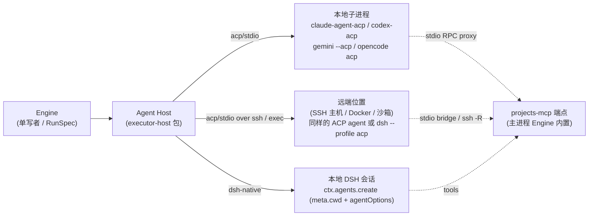

# 执行层：执行者 × 模型 × 位置

> 状态：现行（v4，2026-11-08，采纳 ADR-0013–0018）。意图见 [../product/intent.md](../product/intent.md)；证据见 [../research/dsh-capabilities.md](../research/dsh-capabilities.md)、[../research/external-agents-cloud.md](../research/external-agents-cloud.md)。

## 1. 结论

- 每次运行由一份**不可变的运行规格** `RunSpec{executor, model, effort, permission, location}` 描述。任务只存偏好，运行存事实。
- 执行者只有**两种传输**：`dsh-native`（本地 DSH 会话，保真度最高）与 `acp`（其余一切，包括远端的 DSH）。
- 位置的定义是「**代码和 agent 进程所在的地方**」。远端执行 = 在远端检出代码并在远端起 agent，经 stdio 桥回本机 Project Host；Host lease 失效时远端 Run 进入 `stale`，不再接受写命令。
- Projects 给执行者的工具（提问、回报、写上下文）统一做成一个 **MCP 服务**；DSH 原生会话直接注册为工具，外部执行者经 ACP `session/new.mcpServers` 拿到同一套。所有调用经过 Engine 的 Run capability 校验，不以 bearer token 中的 Task id 代替授权。
- 仓库环境文件是可执行输入，不是天然可信配置。首次执行或 hash 改变时需要人确认；不受信仓库默认使用隔离 HOME、无 SSH agent、无 runtime secrets 的 sandbox。
- 不使用 DSH 现有的 `subagent-acp / subagent-claude-code / subagent-codex` 来跑项目任务：它们是一次性的，丢弃过程事件，自动应答权限，不能按次选模型（`subagent-acp/src/run.ts:420-452`）。它们仍可作为 worker 内部的子代理工具使用。



## 2. 运行规格（RunSpec）

```ts
type RunSpec = {
  executor: ExecutorId          // 'dsh' | 'claude-code' | 'codex' | 'gemini' | 'opencode' | 'cursor' | <自定义>
  model?: string                // 执行者目录里的 id；执行者不支持选模型时为空
  effort?: string               // reasoning / thought level，执行者支持时
  permission: 'read-only' | 'workspace-write' | 'full'   // 映射到各执行者的原生模式
  approval: 'ask' | 'auto-safe' | 'never-ask'            // 权限请求是否转人审批
  location: LocationId          // 'local' | 'ssh:<host>' | 'docker:<name>' | 'sandbox:<provider>/<env>'
  credential: CredentialRef     // 'cli-login' | 'credential:<id>'（DSH credentials 中的 API Key）
  trust: 'isolated' | 'trusted-local' // 是否允许本机 CLI 登录态等额外能力
  validationPolicyRevision?: number   // 采用的受信验证策略版本
}
```

- 解析顺序：任务覆盖 > 负责人（AgentProfile）> 项目角色默认（worker / reviewer）> 执行者默认。
- 启动时写入 `run.spec_json`，之后不改。DSH 原生会话允许运行中切模型（`session-controller/src/commands.ts:166`），记为 `run_event{kind: model_switched}`，不改 spec。
- UI 与协调者摘要始终显示 `执行者 · 模型 · 位置`。

## 3. 执行者（Executor）

### 3.1 接口

```ts
interface ExecutorDriver {
  id: ExecutorId
  transport: 'dsh-native' | 'acp'
  probe(loc: LocationHandle): Promise<Availability>      // 已安装？已登录 / 有 Key？版本？
  capabilities(loc): Promise<Capabilities>                // resume、fork、选模型、权限请求、用量、plan、diff
  catalog(loc): Promise<ModelCatalog>                     // 动态发现模型与 effort
  start(spec: RunSpec, ws: CheckoutHandle, brief: Brief): Promise<RunHandle>
  prompt(run, message, operationId, mode: 'queue' | 'steer'): Promise<DispatchReceipt>
  resolvePermission(run, requestId, decision, optionId): Promise<PermissionReceipt> // 回应原始协议请求
  reconcile(operationId): Promise<DispatchReceipt | 'not-found' | 'unknown'>
  resume(run): Promise<RunHandle>                         // 能力不支持时抛 Unsupported
  cancel(run): Promise<void>
  nativeSessionRef(run): { kind: string; id: string } | null   // 用于续接与交接
}
```

`RunHandle` 输出统一事件流（借 ACP `session/update` 语义，按 ACP v2 的生命周期建模，便于以后升级）：

| 事件 | 含义 | 存储与广播 | UI |
|---|---|---|---|
| `message` / `thought` | 文本与思考流式增量（chunk） | 内存缓冲 + SSE 实时广播 + 追加写 `<dataDir>/runs/<run_id>.jsonl`；仅在 `turn_end` 时将完整消息摘要写入 SQLite `run_event` | 运行视图对话流 |
| `tool_call` / `tool_call_update` | 工具调用，含 kind（read / edit / execute / fetch…）与 diff | 起止状态写入 SQLite `run_event`；流式输出写 `.jsonl` | 过程行、Files Changed |
| `plan` | 执行者的计划项 | SQLite `run_event` | 运行视图顶部 |
| `permission_request` | 需要批准的动作 | SQLite `run_event` + `question` 表（含 transport、request id、Run epoch；挂起 RPC resolver 留在 provider channel） | 托盘（Question kind=gate, scope=action）；回答直接返回原 RPC |
| `usage` | token / 成本（执行者提供时） | SQLite `run_event` + `run.usage_json` | 运行头、项目预算 |
| `state` | running / idle / requires_action / exited(reason) | SQLite `run_event` + `run.activity` | 推导显示状态 |

**`prompt(run, message, operationId, mode)` 的传输层映射**：
- `dsh-native`：先由 Engine 校验 Run capability，再映射为 DSH 会话的 `inbox` 投递（`mode='queue'` 走 `followup`，`mode='steer'` 走 `steer`）。回执写入对应 effect，不把模型响应当作投递回执。
- `acp`：ACP v1 的 `session/prompt` 是阻塞到本轮结束的同步 RPC，没有原生运行中 `steer`。`executor-host` 把每条消息先持久化为带 `operationId` 的 delivery effect，再在 `run:<id>` lane 内串行发送：
  - `mode='queue'`：从持久队列取出，等当前在途 `session/prompt` 返回后发送下一条；队列不能只存在内存。
  - `mode='steer'`（仅人显式「插话」时）：先向该会话发送 `session/cancel`，等待在途 prompt 以 `stopReason='cancelled'` 返回后再发送新 prompt。cancel 可能打断工具调用并留下半写文件，因此必须先产生风险 Question 或执行隔离回滚。
- ACP `session/request_permission` 不走 `prompt`、`run.deliver` 或 `steer`。Agent Host 保存原始 request id 与 resolver；Question 回答调用 `resolvePermission` 直接回应该 RPC，成功后才写 Question answered 和审计。
- 远端操作在本机 ack 前崩溃时先调用 `reconcile(operationId)`。不能查询或去重的 provider 返回 `unknown`，冻结同一 Run/Attempt 的冲突 effect 并转人工对账，不自动重发。

### 3.2 驱动清单

| 执行者 | 本地 | 远端 | 选模型 | 续接 | 备注 |
|---|---|---|---|---|---|
| **DSH** | `dsh-native`：`ctx.agents.create({ sessionId, meta: { cwd, agentPreset }, agentOptions: { model }, setup })` | `acp`：远端 `dsh --profile acp` | 是（`agentOptions` 初始模型 / ACP `set_config_option`） | 是（ACP `session/resume`） | 本地运行保持 `delegationDepth=0` 的完整 DSH 会话（可用子代理与文件上传），不调用 `sessionController.selectModel` 以免篡改用户全局默认模型 |
| **Claude Code** | `acp`：`@agentclientprotocol/claude-agent-acp` | 同左（远端安装） | 是 | 是（会话文件在本地磁盘） | 远端必须 API Key（`--bare` + `ANTHROPIC_API_KEY`，`--hide-claude-auth`） |
| **Codex** | `acp`：`@agentclientprotocol/codex-acp`（底层 app-server） | 同左 | 是（model、reasoning_effort） | 是 | 远端用 `CODEX_API_KEY` 按次注入 |
| **Gemini CLI** | `acp`：`gemini --acp`（原生） | 同左 | 视版本 | 视版本 | 免费层已迁移到 Antigravity CLI，需确认用户账户类型 |
| **OpenCode** | `acp`：`opencode acp`（原生） | 同左 | 是 | 是 | — |
| **Cursor CLI** | `acp`：`agent acp`（原生） | 同左 | 是 | 否（ACP 会话与 CLI 隔离） | 无用量事件 |
| 自定义 | 用户在设置里登记 `command/args/env` | 同左 | 由 `capabilities` 决定 | 同左 | 与 DSH `subagent-acp` 的配置格式保持一致 |

**能力降级**（显式，不静默）：
- 不支持续接：跟进 = 新会话 + 交接简报（任务原文、上次结论、`git log` 摘要），UI 标注「新会话」。
- 不支持选模型：模型选择器置灰并说明原因。
- 不发权限请求：只允许在 `workspace-write` 且位置是隔离 worktree / 容器时运行；若无法证明隔离则阻断，不自动切到 `never-ask`。
- 不支持回应权限 RPC：进入 `permission_unsupported` / `waiting_on_you`，不得用 steer 伪造批准。
- 不报用量：运行头显示「用量未知」，不计入预算估算。
- 不支持 `list/resume/reconcile`：崩溃后的 launch/delivery 进入 `unknown`，禁止自动重放，要求人工对账。

### 3.3 可选的原生增强（后续）

只有当 ACP 不够用时再加：Claude `stream-json`（成本、子 agent 树、回退到某条消息）、Codex `app-server`（fork、interrupt、rate limit）。接口不变，只是同一执行者多一个驱动实现（vibe-kanban 的分层）。

## 4. 位置（Location）

### 4.1 定义

位置提供四样东西：**一份代码检出（Checkout）**、**一个能起进程的地方**、**一条回本机的 stdio / 隧道**、**跨位置文件同步（pushFile / pullFile）**。

```ts
interface LocationProvider {
  kind: 'local' | 'ssh' | 'docker' | 'sandbox'
  health(): Promise<Health>                                  // 原型中的环境检测与历史
  prepare(env: EnvironmentSpec, repo, ref): Promise<CheckoutHandle>   // 建 worktree / clone / 恢复快照，跑 install
  spawn(checkout, cmd, env): Promise<StdioChannel>           // 在该位置起执行者进程
  exec(checkout, cmd): Promise<ExecResult>                   // 验证命令、git 操作
  pushFile(checkout, localPath, remoteRelPath): Promise<void> // 向检出目录推送上下文或脚本
  pullFile(checkout, remoteRelPath, localPath): Promise<void> // 从检出目录拉取工件到本机
  sync(checkout): Promise<BranchState>                       // WIP 提交、push、preserved ref、读取当前 head_sha
  release(checkout, policy): Promise<void>                   // 回收
  ports?(checkout): Promise<PortForward[]>                   // 预览端口转发
}
```

| 位置 | 检出 | 起进程 | 回本机与 MCP 桥接 | 阶段 |
|---|---|---|---|---|
| `local` | git worktree（`<dataDir>/worktrees/...`，无仓库项目为 `<dataDir>/workspaces/...`） | 本机子进程 | 直接 stdio；MCP 走薄 stdio 代理连本机 Loopback HTTP | M0 |
| `ssh:<host>` | 远端 `git clone` / `worktree`，按项目缓存基础克隆 | `ssh host -- <cmd>` | ssh stdio；MCP 走 `ssh -R 127.0.0.1:0:127.0.0.1:<localMcpPort>` 远端回路转发 | 云端第一步 |
| `docker:<name>` | 容器内 clone 或挂载 worktree | `docker exec -i` | exec stdio；MCP 走容器内 `projects-mcp-bridge.mjs`（经第二条 `docker exec -i` stdio 通道桥接回本机 `executor-host`） | 云端第一步（本机或远端 Docker） |
| `sandbox:e2b` / `sandbox:daytona` | 沙箱内 clone（Daytona 有原生 git API） | 提供商 exec / PTY | 桥接 stdio；**不依赖沙箱出站直连 NAT 后的用户本机**，MCP 由注入沙箱的 `projects-mcp-bridge.mjs` 监听沙箱内 Unix Socket，经 `LocationProvider` 建立的第二条 `exec` stdio 通道回传本机 `executor-host` | 云端第二步 |
| `vendor:*`（Cursor Cloud、Codex Cloud） | 厂商侧 | 厂商侧 | 只有状态、diff、PR | 延后；黑盒，UI 明确标注 |

> 为什么不用 DSH 的 SSH provider：它在**部署级**替换 `ctx.fs / ctx.subprocess`，不能按会话或按任务选择，Web 视图也不认远程路径（`docs/subsystems/ssh.md:27`）。我们需要的是「每个运行一个位置」。

### 4.2 「本地 / 云端」在产品上的呈现

- 用户看到的只有两个选项：**本地**、**云端**；云端下拉选择具体的云环境（「my-vps」「e2b-default」）。
- 一个项目可以配多个云环境，设一个默认。
- 位置的推荐规则（协调者使用，用户可覆盖）：
  - 需要本机的服务、GUI、硬件、私有网络，或用户正在边看边改 → **本地**
  - 长时间运行、需要并行多份、无人值守、best-of-N → **云端**（已配置时）
  - 其余 → 项目默认

### 4.3 环境规格（EnvironmentSpec）

放在仓库 `.dsh/environment.json`（兼容读取 `.devcontainer/devcontainer.json`），与 Cursor / Codex Cloud / Codespaces 的结构一致：

```json
{
  "image": "node:22-bookworm",
  "dockerfile": null,
  "install": "pnpm install --frozen-lockfile",
  "start": ["docker compose up -d db"],
  "validate": "pnpm test",
  "ports": [3000],
  "network": { "allow": ["registry.npmjs.org", "github.com"] },
  "secrets": { "runtime": ["DATABASE_URL"], "build": ["NPM_TOKEN"] },
  "agents": ["claude-code", "codex"]
}
```

- 环境配置先规范化并计算 hash；首次使用或 `install/start/Dockerfile/network/secrets/agents` 发生变化时，必须由人确认实际命令、仓库远端、网络范围和凭据需求。确认记录绑定该 hash，worker 不能替用户确认。
- `install` 必须幂等；结果按 `(repo, lockfile hash, approved config hash)` 做快照。它与 `start`、Docker build 在独立的准备执行环境运行，不继承 agent 的 HOME、SSH agent 或 DSH 凭据。
- `start` 每次起运行时执行，但默认不注入 runtime secrets；build secret 只在用户对对应 build step 单独授权后短时提供。
- `validate` 是该仓库的候选验证命令，在**运行所在位置**执行；生效版本来自人确认的 `validation_policy_revision`，不以当前 worker 分支中的修改自动覆盖。
- `agents` 声明需要在该环境预装的执行者 CLI；准备阶段检查并安装。依赖安装脚本是任意代码，须遵循同一仓库信任确认和 sandbox 规则。
- secrets 只写名字，值来自 DSH `credentials`；构建、运行、agent 进程彼此分开授权，不共享父进程环境。
- 本地位置忽略 `image / network` 配置，但仍受 OS sandbox、仓库信任确认和 capability 约束。不能证明隔离的本地 executor/宿主组合不得宣称安全，启动时应阻断或要求明确的 full-access 风险确认。

## 5. 检出与交接（本地 ⇄ 云端）

域模型调整（详见 [domain-model.md](domain-model.md)）：

- **Attempt = 一条分支**，与位置无关。
- **Checkout = 分支在某个位置上的一份检出**（worktree、容器、沙箱）。一个 Attempt 可以先后有多个 Checkout。
- **Run = 一个执行者会话**，绑定一个 Checkout。

**交接流程（「移到云端」/「拉回本地」）**
1. 停止当前 Run（等当前 step 结束，不硬杀）。
2. 源 Checkout：未提交改动提交为 WIP commit（标记 `[projects-wip]`），push 分支；同时写 preserved ref。
3. 目标位置 `prepare` 新 Checkout，检出该分支，跑 install。
4. 新 Run：同一执行者且支持续接、且会话文件可迁移（Claude、Codex、OpenCode、DSH）→ 带上原会话；否则新会话 + 交接简报。
5. 旧 Checkout 按回收策略释放。
6. 交接写入任务时间线：从哪到哪、带了什么（代码 / 会话 / 仅简报）。

换执行者（「交给 Codex 继续」）走同一流程，只是执行者变了，会话一律不迁移。

## 6. Best-of-N

- 一个 Task 同时开 N 个 Attempt（N ≤ 4），每个 Attempt 一份 RunSpec（不同执行者或模型），各自分支 `agent/<task>-<slug>-<n>`。
- 各候选 Attempt 独立申请 `WorkerSlot`（有几个空槽先启动几个，其余显式显示 `Queued (slot)`，不阻塞等待一次性凑齐 N 个槽位）。
- 全部结束后，validator 各跑一遍；可选派一个只读 `reviewer Run` 写对比结论（`validate` 与 `reviewer Run` 优先复用刚释放的槽位，不被新排队任务抢占）。
- 对比视图：diffstat、验证结果、耗时、用量、reviewer 结论；人选「采用」→ 该 Attempt 进入 For Review，其余标记 `superseded` 并回收 Checkout（分支保留）。
- 显示状态：Task 在所有候选结束前为 In Progress；结束后为 For Review（带「N 选 1」标记）。

## 7. Projects 工具面（projects-mcp）

所有执行者使用同一套 MCP 命令语义；具体可见工具和读写能力由 Run role 与 capability 过滤，Engine 对每次调用再次授权：

| 工具 | 作用 |
|---|---|
| `ask_human(kind, scope, body, options?)` | 提问 / 请求批准（第二轮 Question 模型） |
| `task_report(state, summary)` | 声明 done / blocked / failed |
| `context_read(path)` / `context_search(q)` | 读 Library（由主进程读取本机 `<context_dir>` 返回文本，支持远端位置直接读取） |
| `context_propose(layer, path, body)` | 提议 runbook / 决策 |
| `context_dispute(path, reason)` | 标记 runbook 有误 |
| `artifact_put(path)` | 上交工件（截图、录屏、报告）；远端位置由服务端调 `LocationProvider.pullFile` 拉回本机 `<context_dir>/artifacts/<task>/` 并校验哈希 |

- **单写者约束**：`projects.sqlite` 仅由 DSH 主进程内的 `Engine` 独占写锁。任何外部 stdio 子进程**不得**直接打开 `projects.sqlite`。
- **DSH 原生会话**：直接用 `agent.ctx.tools.register` 注册到 worker preset，进程内直调 `Engine`。
- **本地 ACP 执行者**：`session/new` 时以 `mcpServers` 传入无状态的薄代理脚本 `projects-mcp-stdio.mjs`，它把 MCP JSON-RPC 请求通过本机 Loopback HTTP（`http://127.0.0.1:<dshPort>/projects/mcp` + `Bearer <run_token>`）转发回 DSH 主进程的 `Engine`。
- **远端 ACP 执行者**：不假设远端容器或云沙箱能出站直连 NAT 后的用户本机。SSH 位置走 `ssh -R` 远端回路端口转发；Docker 与 E2B / Daytona 沙箱由 `LocationProvider` 注入薄垫片 `projects-mcp-bridge.mjs`（监听容器内本地 Unix Socket，经第二条 `exec` stdio 通道桥接回宿主机 `executor-host`），携带每次运行的不可猜 capability token。token 只用于定位 Run；Engine 逐次校验 project/task/attempt/repo/path/role/write/epoch/expiry/host lease。
- 所有工具命令执行 capability 校验：`reviewer`、`read-only`、Mandate `write=false`、过期/撤销/暂停/handoff/Host 失联的 Run 不得调用写类工具；跨 repo、跨 Attempt 和越界路径 fail-closed。
- 执行者原生的权限请求（ACP `session/request_permission`）由 Agent Host 转成带原始 request id 的 `Question{kind: gate, scope: action}`；用户回答直接调用 ACP resolver 回应原 RPC，再写 Question 和审计。`approval=auto-safe` 只允许明确的只读安全动作，其余进托盘，不能用 `steer` 代替权限响应。

## 8. 凭据与计费来源

| 位置 | 来源 | 做法 |
|---|---|---|
| 本地 | 用户已登录的 CLI（Claude、Codex、Cursor…） | 默认隔离 HOME 与 SSH agent。用户显式选择 `credential=cli-login` 后，启动摘要标明会使用哪个本机账户；仅在 sandbox 可证明隔离的情况下开放，不读取/复制 token |
| 本地 | API Key | 存 DSH `credentials`，只注入获批的目标 agent 进程；不注入 install/start 和 validator，除非该用途有独立授权 |
| 远端 | **只能** API Key | 按次注入到该执行者进程（不写入环境的全局配置）；Claude 用 `--bare`；不同步 `~/.claude`、`~/.codex/auth.json` |
| 全部 | — | 环境按用途构造，不直接继承父进程：默认隔离 `HOME`、不传 `SSH_AUTH_SOCK`、剥离 `DSH_*` 与敏感变量；仅显式 `credential=cli-login` 可申请本机 provider 登录态，需 sandbox 能力验证和用户确认。每个 DSH 子实例独立 `DSH_HOME`；项目声明变量按获批范围注入 |

UI 在启动摘要和运行头显示计费来源：「本机 Claude 登录」或「API Key · Anthropic（工作）」。

## 9. 验证在哪里跑

- `task_report(done)` 后先停止 worker 当前回合并冻结 Checkout；Engine 固化 WIP commit，读取 `commit_sha`、Git `tree_sha` 和当前验证策略 hash。Run 未退出、Checkout 仍可写、存在未完成写类 effect 或 tree 不稳定时，不启动 validator。
- validator 在独立只读快照上运行受信 `validation_policy_revision`；仓库 `.dsh/environment.json` 只能作为候选策略，首次使用或 hash 改变须由人确认。默认不注入 runtime secrets，网络和凭据按最小范围单独授权。
- 验证通过或失败写入 `evidence` 表时，必须记录 commit/tree SHA、策略版本/hash、运行位置、命令摘要和结果引用。只有全部 provenance 与 Attempt 当前值匹配时，`verified` 才有效；验证期间 HEAD/tree/策略发生变化则写 `stale` 或 `failed`。
- 位置已回收或不可达时，保留 `unknown`/`stale` 状态，不能直接把本地旧结果当作当前证据；可接受的 CI 结果也必须绑定同一 commit/tree 和策略版本。
- 云端运行的工件（截图、日志）经 `artifact_put`（内部调 `LocationProvider.pullFile`）回传到本机 `context/artifacts/<task>/`，Host 失联时不确认上传成功。

## 10. 与 DSH 现有件的关系

| 需要 | 复用 | 自建 |
|---|---|---|
| 本地 DSH 执行者 | `ctx.agents.create({ sessionId, meta: { cwd, agentPreset }, agentOptions: { model }, setup })`、`sandbox-policy`、`permission-presets`、`user-approval` | 把会话绑到 Run；左栏过滤 `origin === 'project-worker'` |
| 远端 DSH 执行者 | `dsh --profile acp`（`packages/acp/acp`） | 远端安装与启动 |
| 外部执行者 | 配置格式对齐 `subagent-acp` | 完整 ACP client（保留事件、权限转人工、按次选模型、续接、合成 `steer`） |
| worktree | `experimental/worktree` 的 create / restore | 路径锁、回收、preserved ref、与 Task 关联 |
| PR | `forge` / `forge-github` / `client-ui-forge` 的 PR 绑定与状态 | 回流给 worker 的规则 |
| 模型目录 | `llm-pi-ai`（DSH 执行者）；ACP `configOptions`（外部） | 统一的目录缓存 |
| 凭据 | `credentials` | 计费来源标注 |
| 远程观察 | Host 远程访问、Liveshare（看 / 接管 DSH 运行） | — |
