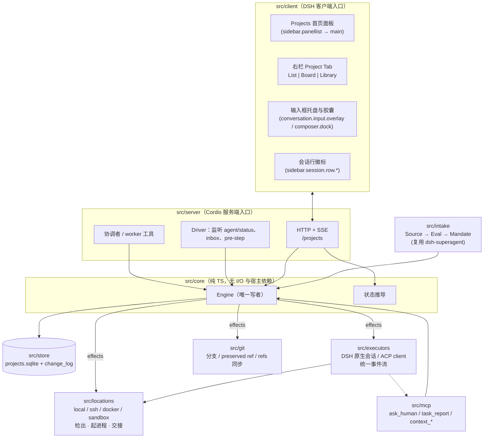

# 架构总览

> 状态：现行（v5，2026-11-09，结合 S0–S7 实测完成单包收敛、原位验证与宿主/远端接缝统一）。产品意图见 [../product/intent.md](../product/intent.md)。取代 `archive/docs/handoff-2026-11-04.md` 与 `archive/docs/dsh-project-layer-2026-11-04.html` 中的落地方案。
> 依据：`deepseek-harness@fcc0ad46`（发布 tag `dsh-v0.2.2-rc.1@66491b05`）、`dsh-superagent-prototype@8c32a9d`、`loopx@8a4d4f9` 源码核查与 S0–S7 真机实测（见 [research/dsh-source-verification.md](../research/dsh-source-verification.md)、[spike/reports/README.md](../spike/reports/README.md)）。

## 1. 要解决的问题

把 agent 的工作单元从「一次会话」提升为「一个持久项目」：

- **冷启动失忆**：每个新会话重新摸一遍怎么构建、怎么测。
- **人肉路由**：并行 5 个会话时，人在窗口间切换，盯谁卡住、谁 CI 红了。
- **会话坟场**：左栏堆满自动命名的会话，半成品分支无人接手。

产品形态（见 [design/interaction-spec.md](../design/interaction-spec.md)）：左栏是项目列表，中栏是常驻的**协调者**会话，右栏是 `List | Board | Library` 项目面板；协调者拆任务、派 worker、收结果，不自己写代码。每个任务可以选**谁做**（DSH 自身、Claude Code、Codex 等）、**用什么模型**、**在哪做**（本地 worktree 或云端），交付分支、PR 与可验证的证据。

## 2. 设计原则

1. **单一真相，其余皆投影。** 所有项目状态由一个单写者引擎写入 SQLite；看板、协调者摘要、左栏徽标、托盘都是只读投影。（LoopX、dsh-superagent）
2. **只存事实，显示状态读时推导。** 存意图（人的决定）与事实（会话活动、PR/CI、提问、证据），不存「In Progress」这类显示状态。（Agent Orchestrator）
3. **验证先于完成。** worker 自报完成只是候选；独立验证（测试命令、CI、PR merged）写入证据后，任务才算完成、记忆才能转正。（LoopX：Decide → Execute → Validate → Commit）
4. **边界写进工具，不写进提示词。** 协调者在工具层面没有写文件、执行命令、长时间等待的能力。（Agent Orchestrator、agtx、dsh-superagent 的教训）
5. **先存后做。** 副作用（启动会话、投递消息、git、GitHub）在事务内入队，提交后执行，失败退避重试，进程重启可恢复。（dsh-superagent）
6. **人永远优先。** 人的输入优先于自动续跑；并发槽之外给人的跟进留一个额外槽；自动化不得替等待中的会话作答。
7. **只用宿主真实存在的扩展点。** 不做 DOM 注入，不依赖 CSS Module 哈希类名。缺插槽就向上游提，或换交互承载方式。
8. **执行者 × 模型 × 位置正交。** 每次运行记录不可变的 RunSpec；外部执行者统一走 ACP；agent 进程跟着代码走；git 分支是交接介质；云端只用用户自己的 API Key（[execution.md](execution.md)）。

## 3. 分层（单包 `dsh-projects` 目录边界）

交付物为**单一 DSH bundle 插件包 `dsh-projects`**（消除多包 workspace 提升引发的 `@deepseek-ai/dsh-scope` 双实例 `Symbol('dsh.scope')` 撕裂，见 [S3 报告](../spike/reports/S3-coordinator-fence.md)），内部按模块目录分层，共用一份 `tsdown` 构建配置（统一 `external: [/^@deepseek-ai\//]`）：

| 模块目录 | 职责 | 不负责 |
|---|---|---|
| `src/core` | 域模型、命令、不变量、状态推导 | 任何 I/O 或 `@deepseek-ai/*` 宿主依赖 |
| `src/store` | `node:sqlite`、迁移、事务、`change_log` | 业务规则 |
| `src/server` | 注册 Cordis 服务、工具、HTTP/SSE、Driver | 直接写表（必须经 Engine） |
| `src/executors` | 执行者驱动（dsh-native、acp）、探测、模型目录、统一事件流、权限请求转 Question | 决定何时启动 |
| `src/locations` | 位置提供者（local / ssh / docker / sandbox）：检出、install、起进程、交接、回收、健康检查 | 选择位置 |
| `src/mcp` | 给所有执行者的统一工具面（进程内注册、本机 `projects-mcp-stdio.mjs` 与远端 `projects-mcp-bridge.mjs`） | 业务规则（转发给 Engine 命令） |
| `src/git` | 分支、refs 同步、preserved ref、WIP 提交 | 合并 PR |
| `src/intake` | 外部事件准入（GitHub / 飞书），产出 Mandate | 交互式对话路径 |
| `src/client` | 全部 UI | 业务状态（只读投影 + 发命令） |

依赖单向（由 ESLint `import/no-restricted-paths` 强制）：`src/client → src/server（仅经 HTTP/类型）`；`src/server → src/core / src/store / src/executors / src/locations / src/mcp / src/git / src/intake`；`src/executors → src/locations`；`src/core` 不依赖任何同级目录或外部 I/O。

## 4. 两条授权路径

| 路径 | 来源 | 准入 | 产物 |
|---|---|---|---|
| 交互 | 人在协调者会话里说话，协调者调用工具 | 消息只产生待授权 Mandate；启动摘要确认、策略确认和高风险命令仍需人的明确操作 | `mandate{origin: chat, granted_by: <user>, scope}` |
| 外部 | GitHub 评论、PR、飞书消息 | 复用 dsh-superagent 的确定性 gate + 模型 assessment；不能扩大已签发 Run 的范围 | `mandate{origin: source, …}` |

两条路径产出同一种 Mandate 记录，审计统一。这取代了旧方案「把人的消息伪装成 Trigger、修改 superagent 的 Eval 幂等键」的做法（见 [ADR-0001](../adr/0001-own-engine.md)）。

## 5. 一次任务的完整生命周期

1. 人对协调者说需求 → 协调者首句确认 → 调 `task_create` 拆出 Task（`intent=ready`），并为每个 Task 推荐 RunSpec（执行者 · 模型 · 位置）。
2. 人在启动摘要确认或修改 → Engine 生成不可变 Mandate、Run capability 和 RunSpec；依赖满足、槽位可用后入队 `checkout.prepare`。
3. 位置提供者检出分支、先按受信策略准备环境 → `src/executors` 起执行者（本地 DSH 走原生会话，其余走 ACP）并投递任务原文、检出说明、`INDEX.md`、相关 runbook，挂上受 Run capability 限制的 projects-mcp。
4. worker 运行；统一事件流写入 `activity` 与 `run_event`；右栏实时推导状态。Host 失联时远端 Run 进入 stale，不产生新的已确认事实。
5. worker 需要人（`ask_human` 或执行者的权限请求）→ Question → 协调者会话托盘浮出。普通插话走 `steer`；ACP 权限回答直接回应原 permission RPC。
6. worker 声明完成只产生候选结果。Engine 等待 Run 退出、撤销写 capability、冻结 Checkout 并固化 WIP commit 记录 `(commit_sha, tree_sha)`；validator 在冻结的原 Checkout 上原位复用已装依赖、按受信 `policy_revision` 执行，并在结束后复核 `tree_sha` 与 `git status --porcelain` 未发生变化后，才写 Evidence（verified / failed）。不受信仓库的防逃逸由 `bwrap`/容器隔离门控负责（[ADR-0013](../adr/0013-verified-evidence-and-acceptance.md)、[ADR-0017](../adr/0017-repository-execution-trust.md)）。
7. PR 观察者同步 PR / CI / review；CI 失败、review 意见自动回流给拥有该分支的 worker。外部 effect 通过 operation id 和 receipt 对账，未知结果不自动重放。
8. PR merge 只记录外部事实。人调用 `task_accept`，确认没有 live Run、未完成写入 effect 和 open gate，并附后继 Task 或 `no_followup` 理由后，Task 才完成。
9. 回收：未提交改动存为 preserved ref，按策略删除 worktree，保留分支。

## 6. 文档地图

- 域模型、不变量、状态推导、Schema：[domain-model.md](domain-model.md)
- 执行者 × 模型 × 位置、交接、best-of-N、凭据：[execution.md](execution.md)
- 引擎、协调者、worker、提问、记忆、生命周期：[runtime.md](runtime.md)
- DSH 宿主集成与插槽清单（已核实）：[dsh-integration.md](dsh-integration.md)
- 里程碑与验收：[roadmap.md](roadmap.md)
- 决策记录：[../adr/](../adr/)
- 交互规格与原型对齐：[../design/](../design/)
